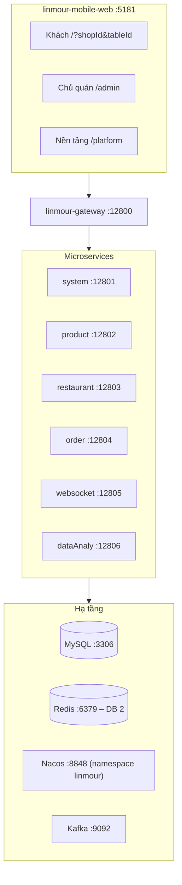

# TÀI LIỆU BÀN GIAO DỰ ÁN QUANLYNHAHANG
## Nền tảng SaaS gọi món tại bàn qua mã QR (phát triển từ Linmour Scan Order)

> **Cập nhật:** 24/10/2026
> **Dành cho:** chủ dự án, kỹ sư tiếp quản.
> **Trạng thái `main`:**
> - **Đã xong:** Mốc 1 (MVP), Mốc 2 (SaaS, PayOS, bếp, báo cáo), Sprint 9 (bảo mật), E2E Playwright.
> - **Còn lại:** các bước nghiệm thu cuối cần chủ dự án (mục 9).
> **Nguồn chi tiết:** spec `docs/specs/2026-10-21-vietnamese-mobile-web-and-admin-design.md` (mục 4.6: khung tin WebSocket); thiết kế giao diện ban đầu trong `docs/design/`.

---

## 1. Tổng quan

QUANLYNHAHANG chuyển Linmour Scan Order (WeChat mini-program + admin tiếng Trung, một quán) thành **nền tảng SaaS đa quán cho Việt Nam**:
- **Việt hoá**: giao diện, thông báo lỗi, tiền VNĐ (`formatVND`), dữ liệu mẫu.
- **Ba khu vực trong một ứng dụng React**: khách `/`, chủ quán `/admin/*`, admin nền tảng `/platform/*`.
- **Thanh toán**: tiền mặt (`payType 4`), VietQR tĩnh (`1`, cần biến `VITE_VIETQR_*`), **PayOS** (`5`): link + QR động, webhook HMAC-SHA256, chống lệch tiền, trang đối soát.
- **Bảo mật**:
  - bỏ cửa hậu `Token: 1`;
  - token nội bộ `X-Internal-Token` (gateway xoá header này từ client, chặn `/internal/**`);
  - JWT secret và khoá mã hoá PayOS lấy từ cấu hình, thiếu thì service không khởi động;
  - chống truy cập chéo quán (Q7, trong `linmour-security` `TokenOncePerRequestFilter`, cache `merchant:shops:<id>` 10 phút; chủ quán mẹ quản lý được chi nhánh).
- **Bếp (KDS) realtime**: món 0 = Chờ làm → 1 = Đang làm → 2 = Đã lên, đẩy WebSocket cho bàn.
- **Kho**: trừ định mức × số lượng trong transaction, khoá Redisson; hết hàng thì báo khách "Món … đã hết hàng"; chạm ngưỡng thì món tự hạ kệ.

### 1.1. Công nghệ
- **Backend**: Spring Boot 2.3.9 / Spring Cloud Alibaba, Java 11, MyBatis-Plus (tenant interceptor theo `shop_id`), Nacos, MySQL 8, Redis, Kafka + Kafka Streams, Redisson, Feign, JWT.
- **Frontend**: `linmour-mobile-web`: React 18 + TypeScript + Vite + Tailwind + React Router, Vitest, Playwright, lucide-react.

---

## 2. Kiến trúc



| Service | Cổng | Vai trò chính |
|---|---|---|
| `linmour-gateway` | 12800 | Định tuyến; xoá `X-Internal-Token` từ client; trả 404 cho `/internal/**` |
| `linmour-system` | 12801 | Merchant (đăng ký, khoá / mở), quán + chi nhánh, duyệt quán, cấu hình PayOS mã hoá AES-GCM, ký JWT |
| `linmour-product` | 12802 | Danh mục, món, nhóm tuỳ chọn (`selectType`, `required`), kho |
| `linmour-restaurant` | 12803 | Bàn, QR bàn (ZXing, link web theo `app.web-base-url`) |
| `linmour-order` | 12804 | Đơn đang mở (Redis), checkout, trạng thái món, PayOS (tạo link, webhook, đối soát, recheck) |
| `linmour-websocket` | 12805 | `/websocket/shop/{shopId}/table/{tableId}` (bàn), `/websocket/order/{shopId}` (admin): giỏ, đơn, gọi nhân viên, `paid`, `itemStatus`, `payosMismatch`, thống kê |
| `linmour-dataAnaly` | 12806 | Kafka Streams thống kê vào Redis; `shopReport` (R1); `platformRevenue` (P6); job tổng hợp hằng ngày (R2); `rebuildTodayStats` |

**Bảng MySQL hiện có**:
- `lsc_system`: `system_merchant`, `system_shop`, `shop_payment_config`, `system_customer`, `system_dict_data`, `system_dict_type`, `system_menu`.
- `lsc_restaurant`: `restaurant_table`.
- `lsc_product`: `product_info`, `product_sort`, `product_spec_sort`, `product_spec_option`, `product_inventory`, `r_product_inventoty`.
- `lsc_order`: `order_info`, `order_item`, `order_sale`, `payos_transaction`, `undo_log`.
- `lsc_data_analy`: `order_summary_day`, `order_summary_time_period`, `product_summary_day`.

---

## 3. Luồng nghiệp vụ chính

### 3.1. Khách (`/`)
1. Quét QR → `/?shopId=1&tableId=3`.
   - Quán chưa duyệt / tạm ngưng: màn "chờ duyệt".
   - Thiếu tham số: "Mã QR không hợp lệ".
2. Xem menu, chọn tuỳ chọn, giỏ hàng **đồng bộ cả bàn** qua WebSocket.
3. Đặt món (WS `createOrder`). Hết hàng → hiện nguyên văn lý do.
4. Xem đơn của bàn, trạng thái từng món realtime; gọi nhân viên.
5. Thanh toán: tiền mặt / VietQR (nhân viên xác nhận), hoặc **PayOS**:
   1. `POST /app/order/order/payos/create {tableId}` → QR + đếm ngược 15 phút. Mỗi bàn chỉ 1 link `PENDING` còn hạn: có khoá Redisson; đơn đổi thì link cũ bị huỷ.
   2. PayOS gọi `POST /app/order/order/payos/webhook`.
   3. Backend kiểm chữ ký, chỉ checkout khi **cả 3 điều kiện** đúng: đơn mở có `id == tx.orderId`, `payAmount == tx.amount`, tiền webhook `== tx.amount`.
   4. Đúng → checkout `payType 5`; bàn nhận `paid` → màn "Cảm ơn".

### 3.2. Lệch tiền PayOS (chống mất tiền)
Không đủ 3 điều kiện, link đã huỷ / hết hạn vẫn được trả tiền, hoặc checkout thất bại:
- **không** đóng đơn;
- giao dịch → `PAID_MISMATCH` / `PAID_UNMATCHED`;
- admin nhận `{"msg":"payosMismatch",...}` → thông báo đỏ + âm báo ở `/admin/orders`;
- xử lý ở `/admin/payments`.

### 3.3. Chủ quán (`/admin`)
- Tổng quan hôm nay (`/admin/dashboard`).
- Đơn realtime và thu tiền (`/admin/orders`).
- Bếp (`/admin/kitchen`).
- Món, danh mục, bàn và QR (in A4).
- Cài đặt quán: thông tin, giờ mở / đóng, PayOS (key không bao giờ trả về giao diện, chỉ `clientIdMasked`).
- Đối soát PayOS (`/admin/payments`).
- Báo cáo doanh thu theo ngày / tuần / tháng + CSV (`/admin/reports`).
- Tạo quán mới (`/admin/create-shop`); đăng ký merchant (`/admin/register`).

### 3.4. Nền tảng (`/platform`, chỉ `type = 1`)
- `/platform/shops`: duyệt / từ chối quán, đặt `fee_rate` (%).
- `/platform/merchants`: danh sách, khoá / mở, số quán sở hữu.
- `/platform/revenue`: GMV, hoa hồng theo `fee_rate` từng quán (gồm cả hôm nay), CSV.

---

## 4. Cấu trúc thư mục & quy ước

```
quanlynhahang/
├── linmour-*/            # các microservice Java (Maven multi-module, pom.xml gốc)
├── linmour-mobile-web/   # frontend React (khách + chủ quán + nền tảng)
├── config/nacos/         # file cấu hình đẩy lên Nacos
├── sql/                  # schema, dữ liệu mẫu tiếng Việt, migrations/
├── scripts/              # e2e-reset.sh, payos-fake-webhook.sh
├── docs/specs/, docs/design/
└── start-all-services.sh, stop-all-services.sh, docker-compose-infra.yml
```
- Mỗi tính năng / sửa lỗi một nhánh `feat/<mã>` hoặc `fix/<mã>`, review rồi mới merge vào `main`.
- Commit chỉ đúng file của thay đổi; không commit `.env`, key, log.
- **Bàn thử shop 1**: bàn 1–4 test tay; **bàn 5 dành riêng cho E2E** (bộ E2E tự reset bàn 5); bàn 6–8 test backend.

---

## 5. Quy tắc vận hành (bắt buộc)

1. **Không build jar khi service đang chạy.** `mvn package` ghi đè jar đang chạy → `NoClassDefFoundError`, mọi request trả 500. Đã xảy ra 2 lần (gateway 22/10, order 23/10).
   - Trình tự:
     1. dừng service (`kill`; treo thì `kill -9`), `pgrep -fl linmour` để chắc đã tắt;
     2. `mvn -o -q -pl <module> -am -DskipTests package`;
     3. khởi động, mỗi service đúng 1 tiến trình.
   - Chỉ kiểm code: `mvn test`.
2. **Không `mvn clean`** khi đang có service chạy.
3. **Đổi secret hoặc đẩy lại `security.yml` lên Nacos → khởi động lại cả 7 service.** Nếu không, token lệch giữa các service, trang admin nhận 401 hàng loạt và tự đăng xuất (đã xảy ra 23/10).
4. **Đổi mạng / IP LAN**: Nacos vẫn giữ IP cũ.
   - `./stop-all-services.sh` (**không** kèm `--infra` / `--all`), rồi `./start-all-services.sh`.
   - Script **bỏ qua service đang chạy**, nên phải dừng trước.
5. **JDK 11** bắt buộc (macOS Homebrew: `export JAVA_HOME=/opt/homebrew/opt/openjdk@11`); sai JDK thì Lombok lỗi hàng loạt.
6. **Redis**: dự án dùng **DB 2** (`REDIS_DATABASE` trong `.env`).
   - nếu dùng chung Redis với dự án khác: cấm `FLUSHDB` / `FLUSHALL`;
   - xoá key phải đúng tên, không dùng mẫu rộng.
7. **Frontend cổng 5181** (cấu hình trong `vite.config.ts`).
8. **Không dữ liệu giả trên giao diện chạy thật**: lỗi API thì hiện thông báo tiếng Việt + "Thử lại".
9. **Không** commit hay ghi log key PayOS thật, mật khẩu DB, secret.

---

## 6. Tài khoản, cổng, PayOS khi dev

- **Tài khoản mẫu**: chủ quán `1` / `123` (shop 1 "Nhà Hàng Bếp Việt"), admin nền tảng `2` / `123`.
- **Cổng**:
  - web 5181;
  - gateway 12800;
  - service 12801–12806;
  - Nacos 8848 (`/nacos`);
  - MySQL 3306; Redis 6379 (DB 2); Kafka 9092.
- **PayOS khi dev**:
  - shop 1 có cấu hình **giả**: clientId `po-client-a1b2`, checksum `po-checksum-test`;
  - `linmour-order` chạy `-Dpayos.mock=true`;
  - giả lập PayOS trả tiền: `./scripts/payos-fake-webhook.sh <orderCode> <amount> po-checksum-test`.
- **PayOS thật**:
  1. nhập Client ID / API Key / Checksum Key trong `/admin/settings`;
  2. chạy order **không** có mock;
  3. mở tunnel `cloudflared tunnel --url http://127.0.0.1:12800`;
  4. đăng ký URL `https://<tunnel>/app/order/order/payos/webhook` trên trang PayOS.
  - `start-all-services.sh` mặc định `PAYOS_MOCK=false`; chỉ đặt `PAYOS_MOCK=true` trong `.env` khi dev.

---

## 7. Kiểm thử

| Loại | Lệnh | Hiện trạng `main` |
|---|---|---|
| Frontend unit | `cd linmour-mobile-web && npm test` (+ `npm run lint`, `npx tsc --noEmit`, `npm run build`) | 317/317 |
| Backend unit (JUnit 4) | `export JAVA_HOME=/opt/homebrew/opt/openjdk@11 && mvn -o test` (hoặc `-pl <module> -am`) | 297 test, 0 lỗi |
| E2E Playwright | `cd linmour-mobile-web && npm run e2e` (cần backend đang chạy; tự bật dev server 5181 nếu chưa có) | 6/6 kịch bản |

**Kịch bản E2E chính** (`linmour-mobile-web/e2e/acceptance.spec.ts`):
- **Kịch bản 2 – Gọi món tới PayOS** (shop 1 bàn 5): khách 375×812 đặt món có tuỳ chọn → bếp chuyển Đang làm → Đã lên, khách thấy realtime → PayOS QR → webhook giả → "Cảm ơn" + "Chuyển khoản PayOS" → `/admin/reports` tăng 1 đơn.
- **Kịch bản 3 – Lệch tiền**: tạo link → gọi thêm món → webhook số tiền cũ → thông báo "Lệch tiền PayOS" ở `/admin/orders`, dòng lệch tiền ở `/admin/payments` → trả đúng link mới để đóng bàn.
- **Kịch bản 1 – SaaS**: đăng ký merchant `E2E <timestamp>` → tạo quán (chờ duyệt) → admin nền tảng duyệt → merchant thấy quán đã duyệt.

---

## 8. Tổng hợp story đã merge vào `main`

| Giai đoạn | Story | Ghi chú |
|---|---|---|
| Sprint 0 | S0-1…S0-5 | Dựng `linmour-mobile-web`, REST / WS client, `formatVND`, `buildVietQrUrl`, seed tiếng Việt |
| Sprint 1 – Khách | C1–C8 | Vào bàn, menu, tuỳ chọn, giỏ, đồng bộ bàn, đặt món, đơn của bàn, gọi nhân viên / thanh toán |
| Sprint 2 – Backend | B0–B8, Q1–Q9, R1–R3 (bảo mật) | QR web, gọi nhân viên WS, đóng `Token: 1`, Kafka theo config, WS đa quán, `openOrders`, mở rộng menu, API công khai `/app/**`; Feign path, trạng thái món 0/1/2, địa chỉ / SĐT quán, đăng ký merchant, quán chờ duyệt, chống chéo quán, trừ kho, cấu hình qua `.env` / Nacos |
| Sprint 3 – Admin quán | A1–A9 | Đăng nhập, layout / chọn quán, thông tin quán, danh mục, món, bàn & QR, đơn realtime, gọi nhân viên, thống kê hôm nay |
| Sprint 5 – SaaS | P1–P6 | Đăng ký, tạo quán chờ duyệt, chống chéo quán, chi nhánh, cổng nền tảng, doanh thu & hoa hồng (`GET /dataAnaly/analysis/platformRevenue`) |
| Sprint 6 – PayOS | Y1–Y6, P-1…P-9, F-1…F-8, Y5-UI | Cấu hình theo quán, tạo link, webhook, giao diện khách, đối soát, script webhook giả; sửa lỗi mất tiền, secret mặc định, mock theo key, huỷ link, khoá tạo link |
| Sprint 7 – Sửa backend & bếp | F1–F6 | Địa chỉ quán, Feign path, trừ kho, màn bếp, dọn lỗi phụ, bảo mật cấu hình |
| Sprint 8 – Báo cáo & nghiệm thu | R1, R2, E2E (H2 / R3) | Báo cáo quán, job tổng hợp + dựng lại thống kê, Playwright |
| Sau sự cố 22/10 | A-1…A-10, B-1…B-9 | Bỏ dữ liệu giả, sửa thống kê realtime, token hỏng không chặn API khách, doanh thu nền tảng thật… |
| Sprint 9 – Bảo mật | S9-*, T-1, BUG-* | Chống dò mật khẩu, phiên `jti`, OTP, nhật ký, QR token mờ, vé WS admin, endpoint nội bộ `/internal` |
| Sửa đơn (`feat/order-edit`) | OE-1…OE-6 | Chủ quán thêm / đổi số lượng / xoá món trong đơn đang mở ở `/admin/orders`; giá tính ở máy chủ, trừ / hoàn kho, lý do bắt buộc với món đang làm / đã lên, huỷ link PayOS chờ, WS `orderEdited`, audit `ORDER_EDIT`. Spec `docs/specs/2026-10-31-admin-sua-don.md` |

---

## 9. Việc còn mở (tính đến 24/10/2026)

**Sprint 9 (bảo mật) đã xong**:
- chống dò mật khẩu (SĐT 5 lần, IP 30 lần / 15 phút);
- phiên theo `jti` (8 giờ không hoạt động), đổi mật khẩu, bắt đổi mật khẩu yếu;
- nhật ký thao tác (`/admin/security`, `/platform/audit`);
- OTP 2 lớp (bắt buộc với admin nền tảng);
- đổi key PayOS phải nhập lại mật khẩu, kiểm key thật, lịch sử + banner 24 giờ;
- CORS chỉ cho web của quán;
- in hoá đơn 80 mm;
- xoá API khách tự "thanh toán";
- **QR token mờ theo bàn** (`/?qr=`, `X-Table-Token`, thu hồi khi tạo lại QR);
- **vé WS admin**.

**Việc nhỏ không chặn**:
- E2E màn bếp nên chờ WS sẵn sàng trước khi bấm (lần chạy đầu sau khi khởi động đôi khi fail).
- Kịch bản E2E 2, 3, 6 dùng món id 3 và 6, hiện đang ngừng bán trong dữ liệu quán 1 → cần chọn món theo thực đơn như kịch bản 7.
- `createOrder` cộng `payAmount` theo số tiền máy khách gửi (khách có thể sửa giá qua WS) → nên tính lại giá ở máy chủ bằng `priceQuote`.
- `CategoryManage` gọi `getProductPage` với `pageSize: 200` nhưng máy chủ giới hạn 100 → danh sách món rỗng.
- Thêm món không có ảnh lỗi 500 (`product_info.picture` NOT NULL, không có mặc định).
- Audit `CHECKOUT` dùng `CompletableFuture.runAsync` như `ORDER_EDIT` trước khi sửa → có thể mất bản ghi ngay sau khi khởi động `linmour-order`.

**Nghiệm thu cuối (cần chủ dự án)**:
1. Kiểm kênh PayOS trên my.payos.vn (lỗi `214` = kênh chưa kích hoạt / tạm dừng), nhập key thật trong `/admin/settings`, bật tunnel, thanh toán thật 1 đơn nhỏ, tắt tunnel.
2. **Chuyển hẳn sang QR token**: đặt `SECURITY_ALLOW_RAW_TABLE_IDS=false`, khởi động lại cả 7 service, bấm "Tạo lại tất cả QR" ở `/admin/tables`, **in lại toàn bộ QR** (QR cũ hết hiệu lực).
3. Đổi mật khẩu tài khoản `1`, `2`; bật OTP cho `2` (Google Authenticator, cất 8 mã khôi phục).
4. Chạy tay trọn vòng 2 điện thoại + 1 laptop cùng Wi-Fi; in thử hoá đơn trên máy in nhiệt 80 mm.

**Ngoài phạm vi**:
- deploy cloud / HTTPS production;
- app native;
- đa ngôn ngữ;
- VNPay / MoMo;
- khuyến mãi.

**Rủi ro ghi nhận**:
- trạng thái WebSocket nằm trong RAM của `linmour-websocket` → chỉ chạy 1 instance;
- yêu cầu gọi nhân viên / thanh toán gửi lúc admin chưa mở trang sẽ mất (không lưu lại).
