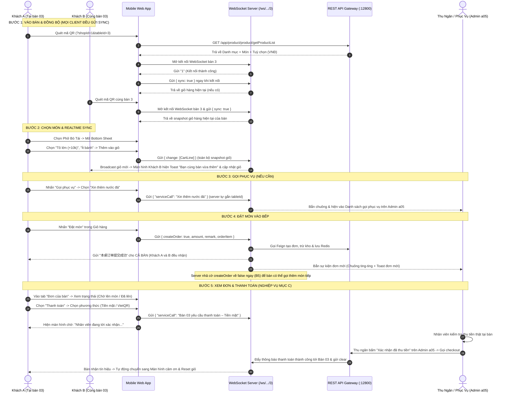
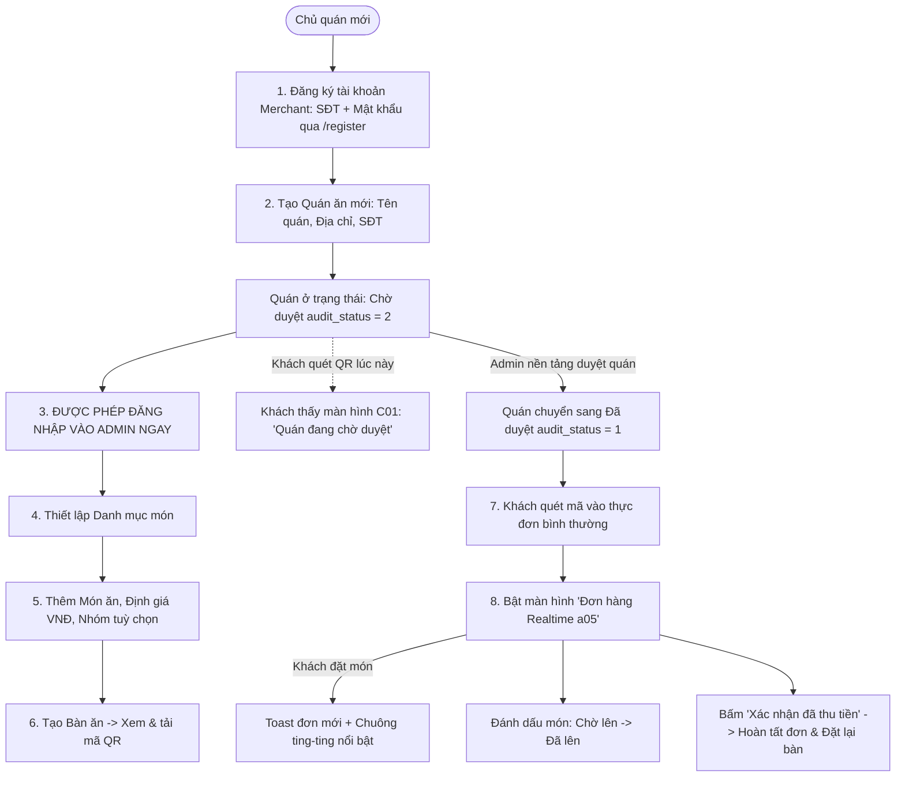
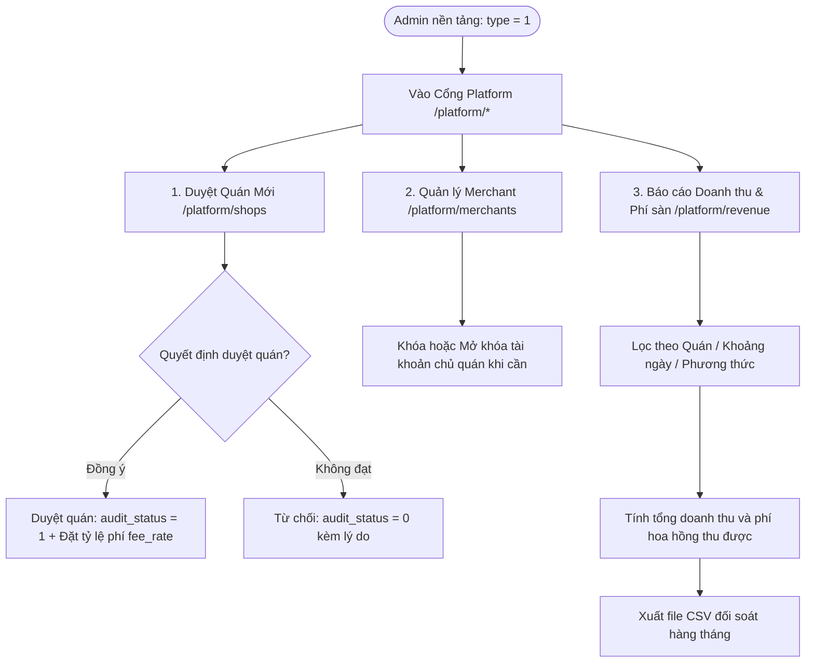
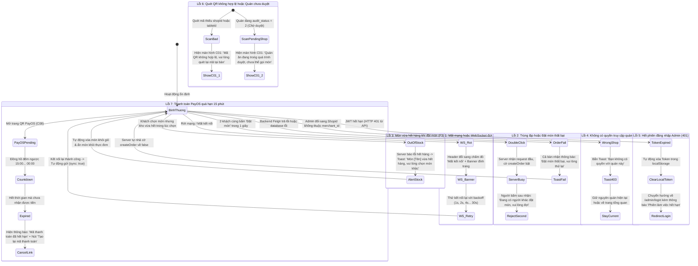

# Luồng Người Dùng (User Flows & State Diagrams) – Đã Cập Nhật Theo PO Review Lần 2b

- **Dự án**: `linmour-mobile-web`
- **Tài liệu**: D2 User Flows (Bản Khôi Phục Đầy Đủ)
- **Tác giả**: Antigravity (Dev) · **Duyệt**: PO (Claude) & Chủ dự án
- **Ngày cập nhật**: 2026-10-21

---

## 1. Luồng Trải Nghiệm Thực Khách Gọi Món (Diner Journey)

Khách quét mã QR tại bàn, gửi `{sync:true}` đồng bộ giỏ ngay lập tức, đặt món vào bếp, và thanh toán qua xác nhận của thu ngân hoặc PayOS tự động.

---

## 2. Luồng Chủ Quán Vận Hành (Merchant Journey)

Chủ quán **được đăng nhập và thiết lập thực đơn/bàn ăn ngay khi quán còn chờ duyệt** (chỉ có link khách quét mã bị chặn thông báo chờ duyệt).

---

## 3. Luồng Quản Trị Viên Nền Tảng (Platform Admin Journey)

---

## 4. Các Nhánh Xử Lý Lỗi (Đầy Đủ 7 Nhánh Theo Yêu Cầu Mục C)

