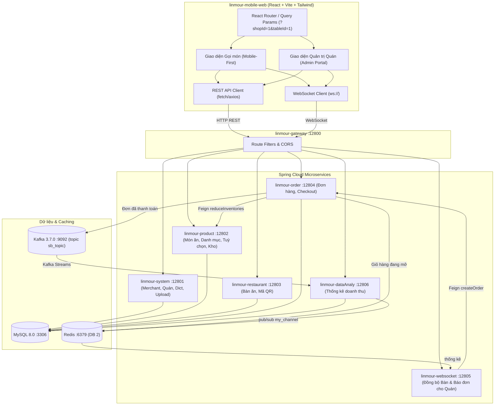

# Bản Đặc Tả Thiết Kế Hệ Thống Gọi Món & Quản Trị Nhà Hàng Việt Nam (Vietnamese QR Order & Admin Web)

- **Ngày tạo**: 2026-10-21
- **Dự án**: `linmour-ScanOrder`
- **Phân hệ mới**: `linmour-mobile-web` (React + TypeScript + Vite + Tailwind CSS)
- **Tác giả / Phụ trách**: Antigravity Pair-Programming

---

## 1. Mục tiêu & Phạm vi (Goals & Scope)

### 1.1 Bối cảnh
Hệ thống backend gốc (`linmour-ScanOrder`) gồm cụm Microservices Spring Cloud Alibaba (Java 11, Gateway, Nacos, MySQL, Redis, Kafka, WebSocket). Tuy nhiên, frontend gốc phụ thuộc vào WeChat Mini-Program (không thông dụng tại Việt Nam) và giao diện quản trị Vue 2 tiếng Trung Quốc, dữ liệu mẫu demo bằng tiếng Trung Quốc.

### 1.2 Mục tiêu
1. **Dành cho Thực khách (Client Mode - Mobile Web)**:
   - Người Việt quét mã QR bằng Camera điện thoại (iOS/Android) hoặc ứng dụng Zalo để vào web gọi món ngay lập tức.
   - Hiển thị tiếng Việt 100%, giá tiền định dạng VNĐ chuẩn (`55.000 đ`).
   - Hỗ trợ chọn tuỳ chọn món (Size tô, độ ngọt, mức đá, topping thêm).
   - Đồng bộ giỏ hàng thời gian thực qua WebSocket giữa nhiều người ngồi cùng một bàn ăn.
   - Tính năng "Gọi nhân viên" (Xin đá, lấy đũa thìa, gọi tính tiền).
   - Thanh toán linh hoạt: Chuyển khoản ngân hàng VietQR (Napas247) tự sinh mã QR theo số tiền và số bàn, Ví MoMo, hoặc Tiền mặt tại quầy.

2. **Dành cho Chủ quán (Admin / Merchant Management Mode)**:
   - Bảng điều khiển quản trị bằng tiếng Việt dễ sử dụng.
   - **Quản lý Quán (`Shop`)**: Đăng ký quán mới, cập nhật thông tin quán (tên quán, địa chỉ, số điện thoại).
   - **Quản lý Bàn ăn (`Table`)**: Thêm bàn mới, xem danh sách bàn, sinh và tải/in mã QR cho từng bàn.
   - **Quản lý Món ăn & Đổi giá (`Product`)**: Thêm món ăn mới, sửa tên món, thay đổi giá bán (VNĐ), bật/tắt trạng thái còn món/hết món, quản lý danh mục món.
   - **Theo dõi Đơn hàng thời gian thực**: Nhận thông báo khi bàn gửi đơn gọi món mới.

3. **Bản địa hóa Dữ liệu (Database Seed Localization)**:
   - Script SQL cập nhật dữ liệu mẫu sang món ăn Việt Nam truyền thống (Phở, Cơm tấm, Bún chả, Cà phê sữa đá, Trà sen vàng...) và các bàn ăn chuẩn tiếng Việt.

---

## 2. Kiến trúc Kỹ thuật (Technical Architecture)



---

## 3. Cấu trúc Thư mục Phân hệ `linmour-mobile-web`

```
linmour-mobile-web/
├── index.html
├── package.json
├── vite.config.ts
├── tailwind.config.js
├── postcss.config.js
├── tsconfig.json
├── public/
│   └── favicon.ico
└── src/
    ├── main.tsx
    ├── App.tsx
    ├── types/
    │   ├── api.ts             # Result<T> { code, msg, data }, PageResult<T> { list, total }
    │   ├── product.ts         # AppProductSort, ProductDetailDto, ProductSortAndOption, ProductSpecOption
    │   ├── order.ts           # OrderInfo, OrderItem, SeatOrderDto, CreateOrderDto, CheckoutDto
    │   ├── restaurant.ts      # RestaurantTable, Shop
    │   └── websocket.ts       # Message theo key: change / sync / createOrder / clear (xem 4.2)
    ├── services/
    │   ├── api.ts             # REST client gọi gateway :12800; khách gửi header Shopid, admin gửi thêm Token: <jwt>
    │   └── websocket.ts       # WebSocket singleton: /websocket/shop/{s}/table/{t} (khách), /websocket/order/{shopId} (admin)
    ├── context/
    │   ├── CartContext.tsx    # State giỏ hàng, đồng bộ thời gian thực giữa các khách cùng bàn
    │   └── ToastContext.tsx   # Thông báo popup (toast)
    ├── components/
    │   ├── client/            # Các thành phần dành cho Thực khách
    │   │   ├── ClientHeader.tsx
    │   │   ├── CategoryNav.tsx
    │   │   ├── ProductItem.tsx
    │   │   ├── ProductModal.tsx (Chọn phân loại/topping)
    │   │   ├── CartDrawer.tsx
    │   │   ├── CheckoutModal.tsx (VietQR, MoMo, Tiền mặt)
    │   │   └── ServiceCallModal.tsx (Gọi nhân viên, xin đá — cần bổ sung backend, xem mục 7)
    │   └── admin/             # Các thành phần dành cho Chủ quán
    │       ├── AdminLayout.tsx
    │       ├── LoginPage.tsx (Đăng nhập merchant, lưu JWT)
    │       ├── ShopManage.tsx (Đăng ký & đổi thông tin quán)
    │       ├── TableManage.tsx (Thêm bàn, tải/in mã QR)
    │       ├── ProductManage.tsx (Thêm món, sửa món, đổi giá, hết hàng)
    │       └── OrderMonitor.tsx (Theo dõi đơn hàng tại các bàn)
    └── utils/
        ├── currency.ts        # formatVND(55000) => "55.000 đ"
        └── vietqr.ts          # Tạo link ảnh mã VietQR tự động theo số tiền
```

---

## 4. Đặc tả API & Giao thức Tích hợp

> Mọi endpoint dưới đây đã được đối chiếu với controller và DTO trong backend hiện tại. Đường dẫn là đường dẫn qua gateway `http://127.0.0.1:12800`.

### 4.0 Quy ước chung
- **Định dạng phản hồi**: mọi REST endpoint trả `Result { code, msg, data }`. HTTP status luôn là 200; thành công khi `code === 200`, lỗi khi `code` khác 200 (ví dụ `201` lỗi chung, `401` cần đăng nhập, `500` lỗi hệ thống, `80401` đơn không có món). Danh sách phân trang trả `data = PageResult { list, total }`.
- **Header**:
  - Thực khách: chỉ cần `Shopid: <shopId>`. Các đường `/app/**` và `/websocket/**` không yêu cầu đăng nhập; backend lấy shopId **từ header**, trường `shopId` trong body (nếu có) bị bỏ qua.
  - Chủ quán: `Token: <jwt>` (lấy từ đăng nhập) + `Shopid: <shopId>` của quán đang thao tác.
  - ⚠️ `Token: 1` là cơ chế nội bộ cho Feign giữa các service (giả lập user id 1). Frontend **không được** dùng giá trị này.
- **Đăng nhập chủ quán**: `POST /system/merchant/login`
  ```json
  { "phone": "1", "password": "123" }
  ```
  Phản hồi `data = { "token": "<jwt>", "userInfo": { ... } }`. JWT hết hạn sau 24 giờ.
  Đăng xuất: `POST /system/merchant/logout/{id}`.
- **Trường `status` của món**: `0` = hết món/ẩn (không hiển thị cho khách), khác `0` = đang bán.

### 4.1 Thực khách gọi món (Client Mode – REST)
1. **Lấy menu kèm tuỳ chọn**: `GET /app/product/product/getProductList`
   - Phản hồi `data` là mảng danh mục `AppProductSort`, mỗi danh mục chứa danh sách món:
     ```json
     [
       {
         "id": 1, "sort": "Phở & Bún Truyền Thống", "shopId": 1,
         "list": [
           {
             "id": 1, "name": "Phở Bò Tái Nạm", "price": 55000, "status": 1,
             "sortId": 1, "sort": "Phở & Bún Truyền Thống", "picture": "...", "intro": "...",
             "productSortAndOptions": [
               {
                 "productSpecSort": { "id": 1, "name": "Size tô", "productId": 1 },
                 "productSpecOptions": [
                   { "id": 1, "name": "Tô lớn", "price": "10000", "specSortId": 1 }
                 ]
               }
             ],
             "inventoryAllList": [ ... ]
           }
         ]
       }
     ]
     ```
   - Lưu ý `productSpecOptions[].price` là **chuỗi**, cần `Number()` trước khi cộng.
2. **Danh mục riêng**: `GET /app/product/sort/getProductSort`.
3. **Đặt món**: `POST /app/order/order/createOrder`
   ```json
   {
     "tableId": 1,
     "amount": 105000,
     "remark": "Ít cay, không hành",
     "orderItems": [
       {
         "productId": 1,
         "name": "Phở Bò Tái Nạm",
         "price": 55000,
         "quantity": 1,
         "propsText": "Tô lớn, Ít bánh",
         "sortId": 1,
         "picture": "..."
       }
     ]
   }
   ```
   - Mô tả tuỳ chọn dùng trường **`propsText`** (không phải `spec`).
   - Bàn đang có đơn mở (lưu trong Redis) thì lần gọi sau **cộng dồn** `amount` vào đơn cũ và ghi đè `remark`.
   - Phản hồi `data = SeatOrderDto { id, payAmount, tableId, list }`.
   - Thông thường khách đặt món qua WebSocket (`createOrder`, mục 4.2) để cả bàn và chủ quán được báo ngay; gọi REST trực tiếp thì chủ quán **không** nhận thông báo.
4. **Thanh toán chốt đơn**: `POST /app/order/order/checkout`
   ```json
   { "tableId": "1", "payType": 4, "openid": "guest_table_1" }
   ```
   - Đơn trong Redis được ghi xuống MySQL, gửi sang Kafka để thống kê, rồi xóa khỏi Redis.
   - `payType` theo từ điển `pay_type` trong `lsc_system`:

     | Giá trị | Nhãn hiện tại | Dùng cho bản Việt Nam |
     |---|---|---|
     | `1` | 支付宝 | Chuyển khoản VietQR |
     | `2` | 微信 | Ví MoMo |
     | `3` | 积分 | (không dùng) |
     | `4` | 现金 | Tiền mặt tại quầy |

     Backend chỉ lưu số nguyên, nên chỉ cần đổi nhãn bằng seed SQL (mục 5). Riêng `payType = 4` thì `openid` không được lưu vào Redis.
5. **Tra cứu đơn của bàn**:
   - Đơn đang mở: `GET /app/order/order/GetCurrentOrderInfo/{tableId}` → `{ orderInfo, orderItems }`
   - Lịch sử đơn đã thanh toán: `GET /app/order/order/GetHistoryOrderList/{tableId}`
   - Chi tiết một đơn: `GET /app/order/order/GetOrderInfoDetail/{orderId}`
   - Đổi trạng thái món thứ `index` trong đơn đang mở (đã lên món/chưa): `POST /app/order/order/updateOrderItemStatus/{tableId}/{index}`

### 4.2 WebSocket đồng bộ giỏ hàng cùng bàn
- URL: `ws://127.0.0.1:12800/websocket/shop/{shopId}/table/{tableId}`
- Khi kết nối thành công server gửi chuỗi `"1"`.
- Message gửi lên là JSON. Server **không đọc trường `type`**: nó phân loại theo **key có mặt** trong object, theo thứ tự `change` → `sync` → `createOrder` → `clear` → các message còn lại. Server tự thêm trường `fromtableId` vào message.

| Key | Payload gửi lên | Server xử lý |
|---|---|---|
| `change` | `{ "change": [ { "productId": 1, "name": "Phở Bò Tái", "price": 55000, "quantity": 2, "propsText": "Tô lớn" } ] }` | Chuyển tiếp nguyên object cho **các kết nối khác** cùng bàn và lưu vào lịch sử thay đổi của bàn |
| `sync` | `{ "sync": true }` | Gửi lại mảng các message `change` đã lưu của bàn **cho chính người gửi** (dùng khi vừa vào bàn) |
| `createOrder` | `{ "createOrder": true, "amount": 105000, "remark": "Ít cay", "orderItem": [ ...OrderItem ] }` | Khoá Redisson theo bàn, gọi Feign `createOrder`, báo cho cả bàn và chủ quán |
| `clear` | `{ "clear": true }` | Xoá lịch sử thay đổi của bàn, mở lại khoá đặt đơn (gọi sau khi thanh toán) |
| (khác) | bất kỳ | Chỉ gửi chuỗi `"1"` cho cả bàn, **không** chuyển nội dung đi đâu |

- Danh sách món khi `createOrder` dùng key **số ít `orderItem`** (khác REST là `orderItems`).
- Message server gửi xuống cho bàn sau `createOrder` (chuỗi tiếng Trung cố định, frontend cần map sang tiếng Việt):
  - `"本桌订单提交成功"` → "Đặt món thành công"
  - `"本桌订单提交失败"` → "Đặt món thất bại"
  - `"已有人提交订单，请稍后"` (chỉ người gửi nhận) → "Đang có người khác đặt món, vui lòng đợi"
  - Từ B-3 (2026-10-22), thất bại có lý do thì server gửi **chuỗi tiếng Việt tuỳ ý** thay cho `"本桌订单提交失败"`, ví dụ `"Món Bánh Mì Thịt Nướng Giòn đã hết hàng"`, hoặc `"Đặt món thất bại"` khi lỗi không rõ. Frontend: khi đang chờ kết quả `createOrder`, mọi chuỗi khác `"1"` và khác 3 chuỗi trên đều là **thất bại**, hiển thị nguyên văn.
- Sau khi đặt thành công, cờ "đã đặt" của bàn vẫn bật; phải gửi `clear` thì bàn mới đặt đơn tiếp được.
- **Gọi nhân viên** (xin đá, đũa thìa, tính tiền): hiện backend **chưa hỗ trợ**, vì message không có key được nhận diện sẽ không tới chủ quán. Xem mục 7.

### 4.3 WebSocket cho Chủ quán
- URL: `ws://127.0.0.1:12800/websocket/order/{shopId}` (mỗi `shopId` giữ một kết nối; kết nối thứ hai cùng `shopId` sẽ thay thế kết nối cũ).
- Khi kết nối: server gửi `{"key":"连接成功"}`.
- **Đơn mới** (khi bàn đặt qua WebSocket):
  ```json
  { "code": 200, "msg": "order", "data": { "id": "...", "payAmount": "105000", "tableId": "1", "list": [ ...OrderItem ] } }
  ```
- **Thống kê**: gửi `{ "dataAnaly": true }`, server trả về `{ orderSummaryDay, productSummaryDay, timePeriodMap }`. Khi có đơn được thanh toán, dataAnaly cũng tự đẩy bản thống kê mới qua kết nối này.

### 4.4 Chủ quán quản trị (Admin Mode – REST)
Tất cả cần header `Token: <jwt>` + `Shopid`.

1. **Quản lý Quán (`Shop`)**
   - Danh sách quán của merchant: `GET /system/shop/shopList` (query: `name`, `shopStatus`, `auditStatus`, `pageNo`, `pageSize`) → `PageResult<ShopPage>`
   - Tạo hoặc cập nhật quán: `POST /system/shop/saveOrUpdateShop`, body là `Shop`; có `id` thì sửa, không có `id` thì tạo mới.
     ```json
     { "id": 1, "name": "Nhà Hàng Bếp Việt", "intro": "Món Việt truyền thống", "position": "Số 128 Đường Xuân Thủy, Cầu Giấy, Hà Nội", "businessHours": "07:00:00" }
     ```
   - ⚠️ Bảng `system_shop` **không có** cột `address`/`phone`. Địa chỉ dùng tạm `position`; muốn có số điện thoại quán phải thêm cột (mục 7).
   - Lấy quán theo id: `GET /system/shop/getShopByIds?ids=1,2` (endpoint dùng cho Feign; trả thẳng mảng `Shop[]`, **không** bọc `Result`)
2. **Quản lý Bàn ăn (`RestaurantTable`)**
   - Danh sách bàn: `GET /restaurant/table/getTable` → `RestaurantTable[] { id, name, status, shopId, serving, dishes, qrCodeUrl }`
   - Tạo bàn: `POST /restaurant/table/createTable`, body `{ "name": "Bàn 06", "size": "430" }` (hoặc bọc trong `{ "dto": { ... } }`).
     - ⚠️ Hiện tại endpoint này gọi API WeChat để sinh mã mini-program, sẽ lỗi nếu không có `wx.appid/secret` hợp lệ. Với bản VN, QR cần trỏ tới link web `/?shopId={s}&tableId={t}` (mục 7). Trong lúc chờ sửa, frontend có thể tự sinh QR từ link này.
   - Cập nhật bàn: `POST /restaurant/table/update`, body là `RestaurantTable` (có `id`), hoặc bọc trong `{ "dto": { ... } }`.
3. **Quản lý Món ăn & Đổi giá (`ProductInfo`)**
   - Danh sách món (phân trang): `GET /product/product/getProductPage` (query: `name`, `sortId`, `status`, `pageNo`, `pageSize`) → `PageResult<ProductDetailDto>`
   - Tạo hoặc cập nhật món, đổi giá: `POST /product/product/saveOrUpdateProduct`, body **bọc trong key `product`**:
     ```json
     {
       "product": {
         "id": 1,
         "name": "Phở Bò Tái Nạm",
         "price": 55000,
         "sortId": 1,
         "intro": "...",
         "picture": "...",
         "specSortAndOption": [ { "productSpecSort": { "name": "Size tô" }, "productSpecOptions": [ { "name": "Tô lớn", "price": "10000" } ] } ],
         "inventoryAllList": []
       }
     }
     ```
     Không có `id` thì tạo mới. Lưu ý: khi **gửi lên** dùng key `specSortAndOption`, còn khi **đọc về** là `productSortAndOptions`.
   - Bật/tắt còn món: `POST /product/product/changeProduct`, body `{ "id": 1, "status": 0 }`
   - Xoá món: `GET /product/product/deletedProduct/{id}`
   - Chi tiết nhiều món: `GET /product/product/getProductDetails?productIds=1,2`
   - Upload ảnh món: `POST /system/upload/uploadImg` (multipart `file`, `prefix`)
4. **Danh mục món**
   - Danh sách: `GET /product/sort/getProductSort`
   - Tạo danh mục: `POST /product/sort/createProductSort`, body `{ "sort": "Cà Phê & Đồ Uống" }`
5. **Theo dõi đơn hàng**
   - Đơn đang mở của một bàn: `GET /order/order/GetCurrentOrderInfo/{tableId}`
   - Tất cả đơn đã lưu của quán: `GET /order/order/GetOrderByShopId`
   - Cập nhật đơn (trạng thái…): `POST /order/order/changeOrder`, body `{ "orderInfoDto": { "id": "...", "orderStatus": 1 } }`
   - Báo đơn mới theo thời gian thực: qua WebSocket mục 4.3.

### 4.5 Bảng đối chiếu với bản spec cũ

| Spec cũ | Endpoint thực tế |
|---|---|
| `GET /system/shop/getShopList` | `GET /system/shop/shopList` |
| `POST /system/shop/createShop`, `POST /system/shop/updateShop` | `POST /system/shop/saveOrUpdateShop` |
| `GET /product/product/getProductList` | `GET /product/product/getProductPage` |
| `POST /product/product/createProduct`, `POST /product/product/updateProduct` | `POST /product/product/saveOrUpdateProduct` (body `{ "product": ... }`) |
| (chưa có) bật/tắt hết món | `POST /product/product/changeProduct` |
| `orderItems[].spec` | `orderItems[].propsText` |
| `checkout` có `shopId` | `shopId` lấy từ header `Shopid` |
| `payType` 1 = Tiền mặt, 2 = VietQR, 3 = MoMo | 4 = Tiền mặt, 1 = VietQR, 2 = MoMo |
| WS `{ "type": "change", "data": [...] }` | WS `{ "change": [...] }` |
| WS `{ "type": "other", "data": "..." }` (gọi nhân viên) | Chưa hỗ trợ (mục 7) |
| Header khách `Token: 1` | Chỉ `Shopid` |

---

### 4.6 Khung tin thật trên dây (đo ngày 21/10/2026 với backend local)

Server mã hoá mọi tin gửi đi bằng `JSON.toJSONString` (`WebSocketCustomEncoding`). Vì vậy các chuỗi ở mục 4.2–4.3 thực tế đến client **ở dạng JSON**:

| Tình huống | Khung tin nhận được |
|---|---|
| Mở kết nối bàn | `"1"` (chuỗi JSON, có dấu ngoặc kép) |
| Kết quả đặt món | `"本桌订单提交成功"`, `"本桌订单提交失败"`, `"已有人提交订单，请稍后"` (có ngoặc kép); từ B-3 thêm chuỗi lý do tiếng Việt, ví dụ `"Món … đã hết hàng"` = thất bại |
| Người khác cùng bàn gửi `change` | `[{"change":[...],"fromtableId":"<tableId>"}]` (mảng 1 phần tử) |
| Trả lời `sync` | mảng mọi message `change` đã lưu, cùng dạng như trên |
| Mở kết nối chủ quán | `"{\"key\":\"连接成功\"}"` (JSON bị mã hoá 2 lần) |
| Sau mỗi tin admin gửi lên | `1` (số) |
| Thống kê | `{"orderSummaryDay":{...},"productSummaryDay":[...],"timePeriodMap":[...]}` |
| Đơn mới (admin) | `{"code":200,"msg":"order","data":{...SeatOrderDto}}` |
| Gọi nhân viên: bàn gửi `{"serviceCall":"..."}` (B2) | Bàn nhận `"Đã gửi yêu cầu tới nhân viên"` hoặc `"Bạn vừa gửi yêu cầu, vui lòng đợi giây lát"` (giới hạn 1 yêu cầu / 5 giây); admin nhận `{"msg":"serviceCall","data":{"tableId":"6","content":"...","time":"2026-10-21T23:14:06"}}` |
| Đã thanh toán (B6, sau `checkout`) | Mọi tab của bàn nhận `{"msg":"paid","data":{"payType":4,"orderId":"…"}}`; lịch sử giỏ của bàn bị xoá, `sync` sau đó trả `[]`. Thanh toán qua PayOS (Y3) dùng `payType: 5`. Từ BUG-TY-1 (24/10) khung có đủ dữ liệu thật: `{"msg":"paid","data":{"payType":4,"payAmount":125000,"orderId":"2113896576886767616","tableName":"Bàn 08","shopName":"…","paidAt":"2026-10-24T14:33:16","items":[{"name":"Bún Chả Hà Nội","quantity":2,"price":50000,"propsText":"Thêm chả nướng"}]}}`; màn cảm ơn và biên nhận dùng khung này |
| PayOS lệch tiền (P-1, chỉ admin) | Admin nhận `{"msg":"payosMismatch","data":{"tableId":"8","orderCode":179272118880,"paidAmount":25000,"dueAmount":60000}}`. Đơn **không** bị đóng; giao dịch `PAID_MISMATCH` (không khớp đơn) hoặc `PAID_UNMATCHED` (checkout thất bại, `dueAmount` = 0) |
| Trạng thái món đổi (Q3, sau `setOrderItemStatus` / `updateOrderItemStatus` của admin) | Mọi tab của bàn nhận `{"msg":"itemStatus","data":{"index":0,"status":2}}`. Quy ước **0 = Chờ làm, 1 = Đang làm, 2 = Đã lên** |

Client phải `JSON.parse` (và parse thêm lần nữa nếu kết quả vẫn là chuỗi JSON) trước khi so khớp. Tin `change` của người khác và tin trả lời `sync` có cùng hình dạng; client tự phân biệt bằng việc mình vừa gửi `sync` hay chưa.

---

## 5. Kịch bản Dữ liệu Việt Nam (`sql/vietnam_sample_data.sql`)

Dữ liệu sẽ được nạp trực tiếp vào MySQL `3306`:
- **Quán ăn**: Đổi shop ID 1 (`lsc_system.system_shop`) thành `name = "Nhà Hàng Bếp Việt"`, `position = "Số 128 Đường Xuân Thủy, Cầu Giấy, Hà Nội"` (bảng không có cột địa chỉ riêng).
- **Danh mục món** (`lsc_product.product_sort.sort`):
  1. `Phở & Bún Truyền Thống`
  2. `Cơm Đĩa & Món Nóng`
  3. `Món Khai Vị & Ăn Vặt`
  4. `Cà Phê & Đồ Uống`
  5. `Tráng Miệng`
- **Món ăn & Giá** (`lsc_product.product_info`, `status = 1`):
  - Phở Bò Tái Nạm (55.000 đ)
  - Phở Gà Ta Thảo Mộc (45.000 đ)
  - Bún Chả Hà Nội (50.000 đ)
  - Cơm Tấm Sườn Bì Chả (45.000 đ)
  - Bánh Mì Thịt Nướng Giòn (25.000 đ)
  - Cà Phê Sữa Đá Sài Gòn (25.000 đ)
  - Cà Phê Muối Cố Đô (30.000 đ)
  - Trà Đào Cam Sả (35.000 đ)
- **Tuỳ chọn món** (`product_spec_sort` / `product_spec_option`): ví dụ "Size tô" (Tô thường +0, Tô lớn +10.000), "Mức đá", "Độ ngọt".
- **Bàn ăn** (`lsc_restaurant.restaurant_table`): Bàn 01 đến Bàn 08, `shop_id = 1`.
- **Từ điển** (`lsc_system.system_dict_data`): đổi nhãn `pay_type` thành `1 = Chuyển khoản VietQR`, `2 = Ví MoMo`, `3 = Điểm thưởng`, `4 = Tiền mặt`; `pay_status` thành `1 = Đã thanh toán`, `2 = Chưa thanh toán`, `3 = Đã huỷ`.

---

## 6. Kế hoạch Kiểm thử & Xác thực (Verification Plan)
1. **Kiểm thử REST API qua Gateway**: gọi các endpoint ở mục 4.1 và 4.4 (`/app/product/product/getProductList`, `/app/order/order/createOrder`, `/app/order/order/checkout`, `/system/shop/shopList`, `/restaurant/table/getTable`, `/product/product/getProductPage`…). Kiểm tra **`code === 200` trong body** (HTTP luôn 200) và dữ liệu trả về là tiếng Việt.
2. **Kiểm thử Giao diện Thực khách (Mobile Web)**:
   - Mở trên trình duyệt mobile / dev tools (iPhone/Android view) với `?shopId=1&tableId=1`.
   - Chọn món, chọn topping, thấy giá cập nhật chuẩn VNĐ (đã cộng `price` dạng chuỗi của tuỳ chọn).
   - Bấm Đặt món (WS `createOrder`) → cả bàn nhận "Đặt món thành công".
   - Mở 2 tab cùng bàn 1: thêm món ở tab A (WS `change`) → tab B cập nhật ngay; mở tab C mới → gửi `sync` và nhận lại giỏ hiện tại.
   - Thanh toán (`checkout`) rồi gửi `clear` → bàn đặt được đơn mới.
3. **Kiểm thử Giao diện Quản trị**:
   - Đăng nhập `POST /system/merchant/login` → lưu `token`, các request sau có header `Token`.
   - Kết nối `/websocket/order/1` → khi bàn đặt món, nhận message `msg: "order"`.
   - Thêm 1 món mới giá 35.000đ (`saveOrUpdateProduct`) → menu phía khách thấy ngay.
   - Đổi giá 1 món → giá mới hiển thị ngay; tắt món (`changeProduct status=0`) → món biến mất khỏi menu khách.
   - Thêm bàn mới (Bàn 06) → có link/QR gọi món cho Bàn 06 (sau khi xử lý mục 7.2).

---

## 7. Khoảng trống Backend cần xử lý

Những phần spec cần mà backend hiện chưa đáp ứng. Mỗi mục cần một thay đổi backend riêng:

1. **Gọi nhân viên qua WebSocket**: thêm handler (ví dụ key `serviceCall`) trong `linmour-websocket/.../chain`, chuyển nội dung tới `/websocket/order/{shopId}` của chủ quán.
2. **Sinh QR không dùng WeChat**: `RestaurantTableServiceImpl.createTable` đang gọi `api.weixin.qq.com`. Cần đổi sang sinh ảnh QR từ link web `https://<domain>/?shopId={s}&tableId={t}` và bỏ URL cứng `127.0.0.1:12800`.
3. **Thông tin quán**: `system_shop` thiếu cột `address`, `phone`.
4. **Bảo mật**: header `Token: 1` cho phép bất kỳ ai giả làm user 1 với mọi `Shopid` (`TokenOncePerRequestFilter`). Ngoài ra khoá JWT đang viết cứng `"sangeng"`.
5. **Thống kê**: `KafkaStreamsApplication` đang viết cứng bootstrap `120.79.7.243:9092`, cần đổi sang `127.0.0.1:9092`/config để thống kê chạy ở môi trường local.
6. **Lời gọi Feign sai đường dẫn**: `OrderFeign.getOrderInfo` (websocket) và `SystemFeign.getMerchantByIds` (order) đang trỏ tới đường dẫn không tồn tại. Hiện chưa ảnh hưởng luồng chính.
7. **Trừ kho**: `reduceInventories` trừ theo định mức cấu hình cho món, bỏ qua `quantity` của đơn.
